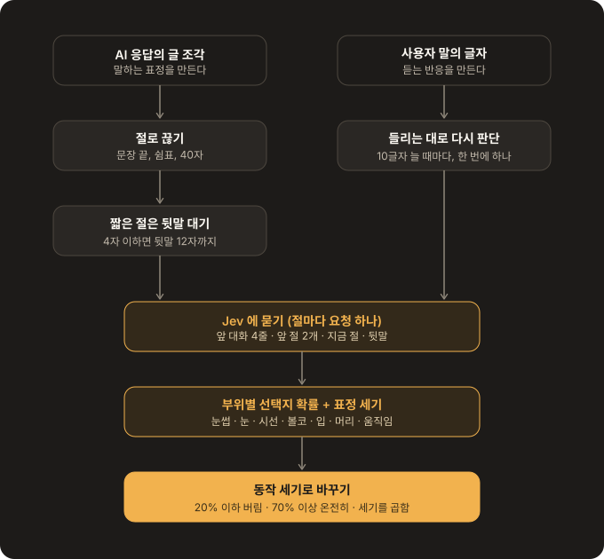
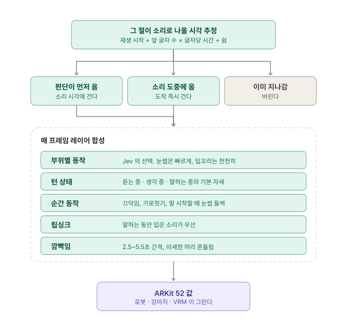

# Faceling

[English](README.md) · **한국어**

**내 AI의 얼굴.** 음성으로 대화하는 AI에게 얼굴을 붙이고, 그 표정을 실시간으로 본다.

> 목소리가 아니라, 말의 뜻으로 짓는 표정.

Faceling 은 AI 가 하는 말과 사용자가 하는 말의 **텍스트**를 보고 얼굴 부위별 동작을 정해, ARKit 52 blendshape 값으로 내보내는 표정 엔진이다. 그리는 쪽은 그 값을 받아 로봇이든 강아지든 원하는 얼굴을 움직이면 된다. 로고와 같은 모양의 기본 얼굴(페이스링)도 들어 있다.

## 무엇을 하나

- **말하는 표정.** AI 응답의 텍스트가 조금씩 도착하는 대로 절 단위로 끊어 판단하고, 그 절이 소리로 나오는 시각에 맞춰 표정을 건다.
- **듣는 반응.** 사용자가 말하는 도중에도 들리는 대로 반응한다. 따라 하는 표정이 아니라 듣는 사람의 표정이다.
- **맥락 반영.** 같은 "그랬군요."도 앞말이 좋은 소식이면 미소, 슬픈 소식이면 걱정하는 얼굴이 된다.
- **부위별 판단.** 눈썹, 눈, 시선, 볼·코, 입, 머리 6곳에 대해 판단 모델이 동작을 직접 고른다. 평범한 말에는 얼굴이 쉰다.
- **얼굴은 자유.** 출력이 ARKit 52 값이라 어떤 렌더러에도 붙는다. 코드로 그린 얼굴 세 가지(로고 모양의 페이스링, 로봇, 강아지)가 들어 있고, VRM 모델도 쓸 수 있다.
- **얼굴이 아니어도.** ARKit 값 아래에는 몸과 상관없는 표현 프레임이 있다. 얼굴 없는 작업대 로봇팔이 함께 들어 있어, 똑같은 판단으로 미안할 땐 축 처지고, 기쁠 땐 번쩍 들리고, 놀라면 움찔하고, 갸우뚱할 땐 손목을 기울인다.
- **가볍다.** 서버에서 영상을 만들지 않는다. 표정 판단은 절마다 0.2~0.3초짜리 API 호출 한 번이다.

## 바로 해 보기

Node.js 22 이상이 필요하다.

```bash
npm install
```

루트의 `.env.example` 을 `.env` 로 복사해 키를 넣는다.

| 키 | 용도 |
|---|---|
| `TYPESAFE_API_KEY` | 표정 판단([Jev](https://docs.typesafe.ai/introduction)). 필수 |
| `OPENAI_API_KEY` | 음성 대화(OpenAI Realtime API). 없으면 소리 없는 모의 대화만 된다 |

```bash
npm run rt:dev
```

http://localhost:5174 를 열면 얼굴과 목소리를 고르는 안내가 나오고, 마지막에 "마이크 허용하고 대화 시작"을 누른다. 자세한 내용은 [실시간 예제](apps/realtime/README.md)에 있다.

얼굴은 안내 화면이나 대화 화면의 "캐릭터 변경"에서 고른다. 페이스링(기본), 로봇, 강아지, 로봇팔(얼굴 없음), 3D 모델이 있다. 3D 는 pixiv 의 예제 모델 [VRM1_Constraint_Twist_Sample](https://github.com/pixiv/three-vrm/tree/dev/packages/three-vrm/examples/models)(© 2022 pixiv Inc., [VRM Public License 1.0](https://vrm.dev/licenses/1.0/))을 실행 중에 인터넷에서 불러오며, 이 저장소에는 들어 있지 않다. 이 모델은 VRM 표준 표정(기쁨, 슬픔, 놀람 등)만 가지고 있어 로봇·강아지보다 표정이 단순하게 보인다. ARKit 표정을 가진 VRM 을 개발자 패널(`` ` `` 키) → "내 VRM 불러오기"로 넣으면 모든 표정이 반영된다.

## 내 앱에 붙이기

Faceling 은 패키지 네 개로 나뉘어 있다. 필요한 것만 쓰면 된다.

| 패키지 | 도는 곳 | 하는 일 |
|---|---|---|
| [`@faceling/core`](packages/core) | 어디서나 | 표정 엔진. `LiveDirector`(대화 사건을 받아 절마다 판단하고 표정을 예약)와 `LiveFace`(부를 때마다 ARKit 52 값 한 장). 의존성 없음 |
| [`@faceling/server`](packages/server) | Node 20 이상 | 키를 서버에만 두는 요청 처리기. Jev 판단 중계, OpenAI Realtime 임시 키 발급 |
| [`@faceling/openai-realtime`](packages/openai-realtime) | 브라우저 | OpenAI Realtime API 에 WebRTC 로 붙어 사건을 엔진에 넘기는 어댑터 |
| [`@faceling/rigs`](packages/rigs) | 브라우저 | 바로 쓸 수 있는 three.js 캐릭터. 페이스링, 로봇, 강아지, 얼굴 없는 로봇팔, VRM 연결. `three` 는 peer 의존성 |

```bash
npm install @faceling/core @faceling/server @faceling/openai-realtime @faceling/rigs three
```

> 아직 npm 에 올리지 않았다. 그전까지는 이 저장소에서 `npm run build` 로 빌드하고 `npm pack -w @faceling/core -w @faceling/server -w @faceling/openai-realtime -w @faceling/rigs` 로 만든 `.tgz` 파일을 설치한다.

### 서버

키는 여기에만 둔다. 환경 변수 `OPENAI_API_KEY`, `TYPESAFE_API_KEY` 를 쓰거나 `apiKey` 옵션으로 넘긴다.

```ts
// server.ts (Node 20 이상)
import { createServer } from 'node:http';
import { createFacelingHandler, toNodeHandler } from '@faceling/server';

// POST /api/session, /api/transcription-session, /api/judge 를 받는다
const api = toNodeHandler(
  createFacelingHandler({
    session: {
      instructions: '당신은 다정하고 표정이 풍부한 대화 상대입니다. 두세 문장으로 짧게 답하세요.',
      language: 'ko',
    },
    transcription: { language: 'ko' },
  }),
);

createServer((req, res) => {
  if (req.url?.startsWith('/api/')) return void api(req, res);
  res.writeHead(404).end(); // 내 웹 앱은 여기서 내준다
}).listen(3000);
```

처리기는 평범한 `Request → Response` 함수라서 다른 프레임워크에도 그대로 들어간다. Express 에서는 `app.use('/api', toNodeHandler(createFacelingHandler()))`, Next.js 에서는 `app/api/[route]/route.ts` 에 `export const POST = createFacelingHandler()`. 하나씩 걸려면 `createJudgeHandler()`, `createSessionHandler()`, `createTranscriptionSessionHandler()` 를 쓴다. **인증이 들어 있지 않다.** 외부에 열기 전에 로그인과 요청 제한을 앞에 넣어야 한다. 그대로 열면 누구나 내 키로 호출할 수 있다.

### 브라우저

```ts
import { LiveDirector, LiveFace, createRemoteJudge } from '@faceling/core';
import { RealtimeConnection } from '@faceling/openai-realtime';
import { FacelingRig } from '@faceling/rigs';
import * as THREE from 'three';

// 엔진: 절마다 내 서버(/api/judge)에 판단을 묻고, 소리에 맞춰 표정을 건다
const clock = () => performance.now() / 1000;
const face = new LiveFace();
const director = new LiveDirector(face, { judge: createRemoteJudge(), clock });

// 어댑터: /api/session 의 임시 키로 OpenAI Realtime 에 WebRTC 로 붙는다
const connection = new RealtimeConnection(director, {
  onStatus: (text) => console.log(text),
  onCaption: (who, text, final) => final && console.log(`${who}: ${text}`),
  onError: (message) => console.error(message),
});
document.querySelector('#start')!.addEventListener('click', () => connection.connect({ greet: true }));

// 얼굴: ARKit 52 값을 받는 렌더러면 무엇이든 된다. 여기서는 기본 얼굴(페이스링).
const renderer = new THREE.WebGLRenderer({ canvas: document.querySelector('canvas')!, antialias: true });
const scene = new THREE.Scene();
scene.add(new THREE.AmbientLight(0xffffff, 1.3), new THREE.DirectionalLight(0xffffff, 2.2));
const camera = new THREE.PerspectiveCamera(24, 1, 0.1, 20);
camera.position.set(0, 1.45, 1.35);
camera.lookAt(0, 1.45, 0);
const rig = new FacelingRig();
scene.add(rig.object);

renderer.setAnimationLoop(() => {
  rig.apply(face.update(clock(), connection.mouth())); // 한 장: ARKit 52 + 머리 + 시선
  renderer.render(scene, camera);
});
```

서버 주소가 다르면 넘겨 준다. `createRemoteJudge({ url })`, `new RealtimeConnection(director, callbacks, { sessionUrl, transcriptionSessionUrl, headers })`. AI 가 먼저 인사할 때 받는 지시는 `greeting` 옵션으로 바꾼다.

기본 얼굴 대신 내 얼굴을 움직이려면 프레임을 직접 읽는다. `face.update(now, mouth)` 는 `{ shapes, head, gaze }` 를 돌려준다. `shapes` 는 ARKit 52 blendshape 이름별 0~1 값, `head` 는 라디안 단위의 `pitch`, `yaw`, `roll`, `gaze` 는 -1~1 의 `x`, `y` 다. VRM 모델은 `@pixiv/three-vrm` 으로 불러와 `@faceling/rigs` 의 `VrmRig` 에 넣는다.

### 얼굴이 아닌 몸

입력과 판단은 무엇이 보여 주든 상관이 없다. 마지막 단계만 다르다. 그래서 프레임마다 출력이 두 가지다.

```
텍스트 → 구절·시각 → 판단(Jev) → 표현 ──┬─ 얼굴 어댑터: ARKit 52 → 페이스링, 로봇, 강아지, VRM
                                       └─ 내 어댑터: 관절 각도 → 로봇팔, 스탠드, 무엇이든
```

`face.update()` 는 ARKit 값과 **함께** 그 바탕이 된 몸과 상관없는 표현 `expression` 을 돌려준다.

| 값 | 뜻 |
|---|---|
| `weights` | 판단한 동작마다 지금 세기 0~1. 키는 `"부위.동작"` (한쪽 동작은 `"@L"`/`"@R"`). 이름은 얼굴 부위지만 감정으로 읽으면 된다. `brows.inner_up` 은 안쓰러움, `head.tilt` 는 갸웃, `mouth.grin` 은 신남 |
| `turn` | AI 가 쉬는지(`idle`), 듣는지(`listening`), 생각하는지(`thinking`), 말하는지(`speaking`). 부드럽게 섞인 값 |
| `gesture` | 지금 순간 동작. `nod`, `shake` (라디안), `flash` (눈썹을 번쩍 올리는 세기) |
| `mouth` | 말하는 동안의 립싱크 세기(`jaw`, `funnel`, `stretch`). 말하지 않으면 0 |
| `blink`, `energy`, `t` | 깜빡임, 지금 가장 강한 동작의 세기, 시각 |

들어 있는 `ArmRig` 가 그 예다. ARKit 값은 전혀 보지 않고 `expression` 을 어깨, 팔꿈치, 손목, 집게 각도로 옮긴다.

```ts
import { ArmRig } from '@faceling/rigs';

const arm = new ArmRig();
scene.add(arm.object);
renderer.setAnimationLoop(() => {
  arm.apply(face.update(clock(), connection.mouth())); // frame.expression 을 읽는다
  renderer.render(scene, camera);
});
```

내 몸을 움직이려면 `frame.expression` 을 같은 식으로 읽는다. 옮기기 편하도록 `@faceling/rigs` 의 `bodyFeelings(expression)` 가 동작들을 몇 가지 느낌(`happy`, `excited`, `sad`, `surprised`, `tense`, `tilt`, `lookAside`, `lookUp`, `lookDown`, `playful`)으로 묶어 준다. 계수는 초안이다.

#### 부탁한 동작 하기

"윙크해 봐", "팔을 오른쪽으로 움직여 봐" 같은 부탁에 도구 호출은 필요 없다. 판단 모델은 원래 말을 보고 부위마다 할 일을 고르므로, 일부러 하는 동작도 선택지 하나일 뿐이다. AI 가 "좋아요, 찡긋!"이나 "네, 오른쪽으로 쭉!"이라고 답하면 같은 구절 판단이 `eyes.wink` 나 `arm.right` 를 고르고, 그 구절이 들리는 순간에 동작이 나온다. "윙크는 못 해요", "오른쪽은 밥 먹는 손 쪽이에요"처럼 동작을 말하기만 하는 문장에는 움직이지 않는다.

- **몸에 따라 다른 부위.** 일부러 하는 동작은 `regions.ts` 에서 `optional` 로 표시한 부위에 있고, 그 몸을 가진 캐릭터에서, AI 가 말하는 구간에만 묻는다. 얼굴 캐릭터는 고개 돌리기 `turn` ("고개 들어 봐", "오른쪽으로 돌려": `up`, `down`, `left`, `right`, `home`)을 `director.parts = ['turn']` 로 넣는다. 로봇팔은 `arm` (`right`, `left`, `up`, `down`, `forward`, `wave`, `home`)을 `director.parts = ['arm']` 로 넣는다. 왼쪽과 오른쪽은 보는 사람 기준이다.
- **감정보다 엄격하게.** 일부러 하는 동작은 확률 50 % 를 넘어야 시작하고 85 % 에서 온전히 하며, 표정 세기와는 상관없다. 윙크도 50 % 를 넘어야 하고 한 응답에 한 번만 한다. 윙크한 것을 설명하는 뒷말에 또 하지 않는다.
- **자세는 남는다.** 부탁받은 고개나 팔 자세는 말이 끝난 뒤에도 5초 동안 유지되고, 다른 동작이 오거나 AI 가 제자리로 돌아간다고 하면(`home`) 그때 바뀐다. 그렇지 않으면 한마디 답에 나갔다가 바로 돌아온다.
- **같은 동작, 다른 몸.** 동작마다 몸별 설명을 따로 둘 수 있다(`regions.ts` 의 `bodies`). 로봇팔은 눈이 없으므로 윙크를 "손목의 불빛이 깜빡인다"로 묻고, 리그는 불빛을 깜빡이며 집게를 찡긋한다.
- **AI 가 자기 몸을 알아야 한다.** 모르면 "저는 움직일 수 없어요"라고 답한다. `createSessionHandler({ characters: { arm: '…' } })` 는 브라우저가 보낸 `character` (`connect({ character: 'arm' })`)에 맞는 몸 설명을 지시 뒤에 붙인다. 예제는 로봇팔에게 할 수 있는 동작과 "한마디로 해 보이기"를 알려 주고, 얼굴 캐릭터에게는 팔이 없다고 알려 준다.

### 다른 음성 대화 서비스

`@faceling/openai-realtime` 은 어댑터일 뿐이다. 다른 음성 대화 서비스에 붙이려면, 그 서비스의 사건이 올 때 `LiveDirector` 의 아래 메서드를 부르는 어댑터를 쓰면 된다. 이것이 전부다.

| 메서드 | 언제 부르나 |
|---|---|
| `assistantStarted()` | AI 응답이 만들어지기 시작 |
| `assistantText(delta)` | 응답 텍스트 조각 도착 |
| `assistantTextDone()` | 응답 텍스트 끝 |
| `assistantAudioStarted()` | AI 음성이 실제로 재생되기 시작 |
| `assistantAudioStopped()` | AI 음성 재생 끝 |
| `assistantInterrupted()` | 사용자가 끼어들어 음성이 끊김 |
| `userSpeechStarted()` / `userSpeechStopped()` | 사용자 말 시작·끝 |
| `userPartial(text)` | 말하는 도중에 들린 글자(이번 발화의 처음부터 지금까지). 없어도 된다 |
| `userTranscript(text)` | 사용자 말의 최종 전사 도착 |

입 모양은 `face.update()` 의 두 번째 인자로 넣는다. `@faceling/core/lipsync` 의 `MouthAnalyser` 가 Web Audio `AnalyserNode` 에서 읽어 준다. 소리가 없으면 `null` 을 넣는다.

## 구성

| 폴더 | 내용 |
|---|---|
| [`packages/core`](packages/core) | 표정 엔진. 부위 정의, 판단 모델에 던지는 질문, 동작 → ARKit 52 대응, 레이어 합성, 실시간 예약 |
| [`packages/rigs`](packages/rigs) | 페이스링·로봇·강아지 얼굴, 얼굴 없는 로봇팔, VRM 연결(three.js) |
| [`packages/openai-realtime`](packages/openai-realtime) | OpenAI Realtime API 브라우저 어댑터 |
| [`packages/server`](packages/server) | Node 처리기. Jev 중계, 임시 키 발급 |
| [`apps/realtime`](apps/realtime) | 위 패키지로 만든 실시간 예제 |
| [`apps/offline-lab`](apps/offline-lab) | 녹음된 대화로 표정을 미리 만들어 돌려 보는 실험 도구. 표정 대응을 다듬을 때 쓴다 |

## 동작 방식

### 전체 구조


브라우저가 OpenAI 에 **직접** 붙는다. 서버는 진짜 키를 숨긴 채 몇 분짜리 임시 키만 내주고, Jev 호출만 대신한다. 음성은 서버를 거치지 않는다. 마이크 소리는 두 곳으로 간다. 하나는 대화 상대(OpenAI Realtime)이고, 다른 하나는 사용자가 말하는 도중에 글자를 받기 위한 전사 연결이다.

### 표정 판단



**무엇을 할지는 판단 모델이 고르고, 코드는 고르지 않는다.** 판단 모델에는 부위마다 "이 말을 하는(또는 듣는) 동안 눈썹은 무엇을 해야 하나"를 선택지와 함께 묻고, 선택지별 확률을 그대로 받는다.

- AI 가 말할 때와 사용자 말을 들을 때는 질문 문구와 선택지 설명이 따로다. 그래서 힘든 이야기를 들을 때 따라서 울상이 되지 않고, 안쓰러워하는 얼굴이 나온다.
- 구절 하나만 보내지 않는다. 앞 대화와 바로 뒤에 이어질 말을 함께 넘긴다. 같은 "정말요?"도 뒤에 "강아지가 아프다니…"가 오면 걱정하며 놀라는 얼굴, "와, 축하드려요!"가 오면 기뻐하며 놀라는 얼굴이 된다.
- 4글자 이하의 짧은 구절은 뒷말을 들어야 뜻이 정해지므로, 뒷말이 12글자쯤 도착할 때까지 판단을 미룬다.

### 시각 맞추기와 합성



AI 응답의 글은 소리보다 1~2초 먼저 도착하므로, 대부분의 구절은 소리가 나기 전에 판단이 끝나 정확히 그 소리에 맞춰 표정이 걸린다. 늦기 쉬운 응답의 첫 구절은 앞머리 몇 글자만 보고 먼저 판단해 두고, 사용자가 방금 말했다면 그때의 듣는 반응을 이어 둔다. 사용자가 말을 끊으면 예약된 표정을 모두 거둔다.

같은 표정이라도 부위마다 따라오는 속도가 다르다. 눈썹과 눈은 빠르게 반응하고, 입꼬리와 볼은 늦게 생겨 오래 남는다. 소리는 입 모양(립싱크)에만 쓰고, 감정은 글에서만 읽는다.

다른 음성 대화 서비스에 붙이려면 그 서비스의 사건을 엔진에 넘기는 어댑터만 쓰면 된다. 엔진이 받는 사건은 [다른 음성 대화 서비스](#다른-음성-대화-서비스)에 정리되어 있다.

그림은 `docs/diagrams/build.mjs` 에서 만든다. 고친 뒤 `node docs/diagrams/build.mjs` 로 한국어·영어판을 함께 다시 만든다.

## 알아 둘 점

- **판단 모델로 Jev 를 쓴다.** 유료 API 이고 키가 필요하다. 분석기는 갈아 끼울 수 있게 되어 있고, 비교용 LLM 분석기 코드가 `apps/offline-lab` 에 있다(실제 키로 돌려 보지는 않았다).
- **말투는 읽지 않는다.** 글자로는 칭찬인데 비꼬는 말투인 경우처럼 소리에만 있는 정보는 반영되지 않는다. 앞뒤 맥락으로 드러나는 반어는 잡는다.
- **대화 텍스트가 판단 모델로 전송된다.** 사용자 말의 전사도 포함된다. 서비스에 넣을 때는 사용자에게 알려야 한다.
- **실험 단계다.** 한국어 대화로만 시험했고, 표정 대응의 계수는 초안이다. 확인하지 못한 것은 각 폴더의 README 에 적어 두었다.
- **예제 서버는 내 PC 전용이다.** 인증이 없으므로 그대로 외부에 열면 안 된다.

## 라이선스

- 코드: [MIT](LICENSE)
- 기본 캐릭터 네 가지(페이스링, 로봇, 강아지, 로봇팔)의 디자인: [CC BY-NC 4.0](packages/rigs/LICENSE.md). 비상업 용도로는 자유롭게 쓸 수 있고, 상업 제품에 쓰려면 허락이 필요하다. 직접 만든 캐릭터에는 이 조건이 적용되지 않는다.

© 2026 RED BRIDGE DEV
