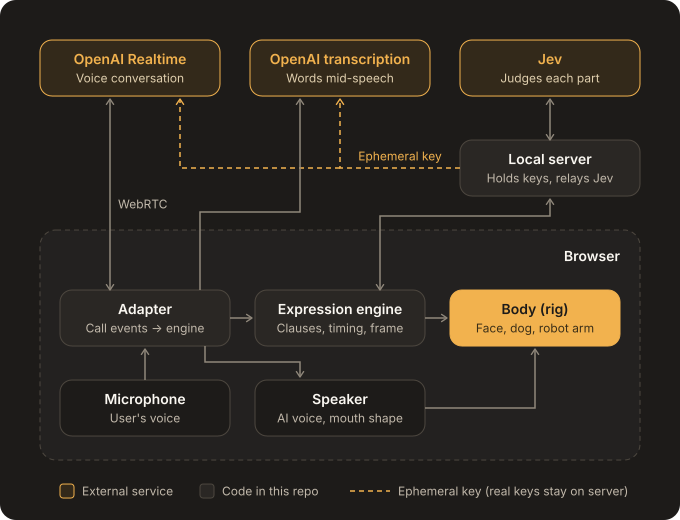

# Faceling

**English** · [한국어](README.ko.md)

**A face for your AI.** Give your voice AI a face and watch its expressions change as it talks.

> Expressions drawn from what is said, not how it sounds.

Faceling is an expression engine for voice AI. It reads the **text** of the conversation — what the AI says and what the user says — decides what each part of the face should do, and outputs ARKit 52 blendshape values in real time. Your renderer takes those values and moves whatever face you like: the built-in Faceling face, a robot, a dog, a VRM avatar.

## What it does

- **Speaking face.** As the AI's reply streams in, it is split into clauses and judged one by one, and each expression is timed to the moment that clause is heard.
- **Listening face.** It reacts while the user is still talking. It does not mirror the user; it reacts the way a caring listener would.
- **Context aware.** The same "I see." becomes a smile after good news and a concerned look after sad news. A short "Really?" takes its feeling from what comes right after it.
- **Per-part judgment.** For six parts of the face — brows, eyes, gaze, cheeks and nose, mouth, head — the judgment model picks an action directly. Plain, factual lines leave the face at rest.
- **Any face.** The output is ARKit 52 values, so it fits any renderer. Three code-drawn faces are included (the Faceling face from the logo, a robot and a dog), and VRM models work too.
- **Not only faces.** Under the ARKit values sits a body-independent expression frame. A faceless workbench robot arm is included: from the very same judgment it slumps when it is sorry, perks up when it is glad, flinches when surprised and tilts its wrist when puzzled.
- **Lightweight.** No server-side video. Each clause costs one API call of about 0.2–0.3 s.

## Try it

Requires Node.js 22 or later.

```bash
npm install
```

Copy `.env.example` in the repository root to `.env` and fill in the keys.

| Key | Used for |
|---|---|
| `TYPESAFE_API_KEY` | Expression judgment ([Jev](https://docs.typesafe.ai/introduction)). Required |
| `OPENAI_API_KEY` | Voice conversation (OpenAI Realtime API). Without it, only the silent demo works |

```bash
npm run rt:dev
```

Open http://localhost:5174. A three-step intro asks you to pick a face and a voice, then press "마이크 허용하고 대화 시작" (allow microphone and start) or "텍스트로만 대화할게요" (text only). Without an OpenAI key you get "예시 대화 보기" (watch a sample conversation) instead, which drives the face without sound. Press `` ` `` or add `?dev` to the URL to open the developer panel. The demo UI is in Korean for now.

Pick a face in the intro or later with "캐릭터 변경" (change character): 페이스링 (the Faceling face, the default), 로봇 (robot), 강아지 (dog), 로봇팔 (robot arm, no face) and 3D 모델 (3D model). The 3D option loads pixiv's sample model [VRM1_Constraint_Twist_Sample](https://github.com/pixiv/three-vrm/tree/dev/packages/three-vrm/examples/models) (© 2022 pixiv Inc., [VRM Public License 1.0](https://vrm.dev/licenses/1.0/)) from the web at runtime; it is not included in this repository. That model only has the standard VRM expressions (happy, sad, surprised and so on), so its face looks simpler than the robot and dog. Load your own VRM with ARKit blendshapes from the developer panel → "내 VRM 불러오기" (load my VRM) to see every expression.

## Add it to your app

Faceling is split into four packages. Use only the ones you need.

| Package | Runs in | What it gives you |
|---|---|---|
| [`@faceling/core`](packages/core) | anywhere | The engine: `LiveDirector` (takes conversation events, judges clauses, schedules expressions) and `LiveFace` (one frame of ARKit 52 values per call). No dependencies |
| [`@faceling/server`](packages/server) | Node 20+ | Request handlers that keep your keys on the server: Jev judgment relay and OpenAI Realtime ephemeral keys |
| [`@faceling/openai-realtime`](packages/openai-realtime) | browser | Adapter that connects to the OpenAI Realtime API over WebRTC and feeds its events to the engine |
| [`@faceling/rigs`](packages/rigs) | browser | Ready-made three.js characters: the Faceling face, robot, dog, a faceless robot arm and a VRM adapter. `three` is a peer dependency |

```bash
npm install @faceling/core @faceling/server @faceling/openai-realtime @faceling/rigs three
```

> The packages are not on npm yet. Until they are, build them from this repository with `npm run build`, then `npm pack -w @faceling/core -w @faceling/server -w @faceling/openai-realtime -w @faceling/rigs`, and install the resulting `.tgz` files.

### Server

The keys stay here. Set `OPENAI_API_KEY` and `TYPESAFE_API_KEY` in the environment, or pass them as `apiKey` options.

```ts
// server.ts (Node 20+)
import { createServer } from 'node:http';
import { createFacelingHandler, toNodeHandler } from '@faceling/server';

// Serves POST /api/session, /api/transcription-session and /api/judge
const api = toNodeHandler(
  createFacelingHandler({
    session: {
      instructions: 'You are a warm, expressive companion. Keep replies to two or three sentences.',
      language: 'en',
    },
    transcription: { language: 'en' },
  }),
);

createServer((req, res) => {
  if (req.url?.startsWith('/api/')) return void api(req, res);
  res.writeHead(404).end(); // serve your web app here
}).listen(3000);
```

The handlers are plain `Request → Response` functions, so they fit other frameworks too: `app.use('/api', toNodeHandler(createFacelingHandler()))` in Express, or `export const POST = createFacelingHandler()` in a Next.js route at `app/api/[route]/route.ts`. Use `createJudgeHandler()`, `createSessionHandler()` and `createTranscriptionSessionHandler()` to mount them one by one. **They have no authentication.** Put your own login and rate limit in front of them before you expose them, or anyone can spend your keys.

### Browser

```ts
import { LiveDirector, LiveFace, createRemoteJudge } from '@faceling/core';
import { RealtimeConnection } from '@faceling/openai-realtime';
import { FacelingRig } from '@faceling/rigs';
import * as THREE from 'three';

// The engine: judges each clause through your server (/api/judge) and times it to the audio
const clock = () => performance.now() / 1000;
const face = new LiveFace();
const director = new LiveDirector(face, { judge: createRemoteJudge(), clock });

// The adapter: OpenAI Realtime over WebRTC, using ephemeral keys from /api/session
const connection = new RealtimeConnection(director, {
  onStatus: (text) => console.log(text),
  onCaption: (who, text, final) => final && console.log(`${who}: ${text}`),
  onError: (message) => console.error(message),
});
document.querySelector('#start')!.addEventListener('click', () => connection.connect({ greet: true }));

// The face: any renderer that takes ARKit 52 values. Here, the built-in Faceling face.
const renderer = new THREE.WebGLRenderer({ canvas: document.querySelector('canvas')!, antialias: true });
const scene = new THREE.Scene();
scene.add(new THREE.AmbientLight(0xffffff, 1.3), new THREE.DirectionalLight(0xffffff, 2.2));
const camera = new THREE.PerspectiveCamera(24, 1, 0.1, 20);
camera.position.set(0, 1.45, 1.35);
camera.lookAt(0, 1.45, 0);
const rig = new FacelingRig();
scene.add(rig.object);

renderer.setAnimationLoop(() => {
  rig.apply(face.update(clock(), connection.mouth())); // one frame: ARKit 52 + head + gaze
  renderer.render(scene, camera);
});
```

If your server lives elsewhere, pass the URLs: `createRemoteJudge({ url })` and `new RealtimeConnection(director, callbacks, { sessionUrl, transcriptionSessionUrl, headers })`. The adapter's status messages and default greeting are in Korean for now; pass `greeting` to change what the AI is told to open with.

To drive your own face instead of the built-in one, read the frame yourself. `face.update(now, mouth)` returns `{ shapes, head, gaze }`: `shapes` maps ARKit 52 blendshape names to 0–1, `head` holds `pitch`, `yaw` and `roll` in radians, and `gaze` holds `x` and `y` from −1 to 1. For a VRM model, load it with `@pixiv/three-vrm` and use `VrmRig` from `@faceling/rigs`.

### Beyond faces

The input and the judgment do not care what body shows them; only the last step does. Each frame carries two outputs:

```
text → clauses and timing → judgment (Jev) → expression ──┬─ face adapter: ARKit 52 → Faceling, robot, dog, VRM
                                                           └─ your adapter: joint angles → robot arm, lamp, anything
```

`face.update()` returns the ARKit values **and** `expression`, the body-independent frame they were made from:

| Field | Meaning |
|---|---|
| `weights` | Current strength 0–1 of each judged action, keyed `"part.action"` (`"@L"`/`"@R"` for one-sided ones). The names are face parts, but read them as feelings: `brows.inner_up` is sympathy or sorrow, `head.tilt` is puzzlement, `mouth.grin` is delight |
| `turn` | How much the AI is `idle`, `listening`, `thinking` or `speaking`, blended smoothly |
| `gesture` | Momentary moves right now: `nod` and `shake` (radians) and `flash` (a quick brow raise) |
| `mouth` | Lip-sync energy while speaking (`jaw`, `funnel`, `stretch`), 0 otherwise |
| `blink`, `energy`, `t` | Blink amount, the strongest action right now, and the time |

The built-in `ArmRig` is an example. It never looks at ARKit values; it turns `expression` into shoulder, elbow, wrist and claw angles:

```ts
import { ArmRig } from '@faceling/rigs';

const arm = new ArmRig();
scene.add(arm.object);
renderer.setAnimationLoop(() => {
  arm.apply(face.update(clock(), connection.mouth())); // reads frame.expression
  renderer.render(scene, camera);
});
```

To drive your own body, read `frame.expression` the same way. `bodyFeelings(expression)` from `@faceling/rigs` condenses the actions into a few feelings (`happy`, `excited`, `sad`, `surprised`, `tense`, `tilt`, `lookAside`, `lookUp`, `lookDown`, `playful`) if that is easier to map. Its coefficients are a first draft.

#### Doing what it is asked

"Wink at me." "Move your arm to the right." These need no tool calling. The judgment model already decides what each part does from what is said, so a deliberate move is just another option: when the AI replies "Sure, *wink*!" or "Okay, all the way to the right!", the same per-clause judgment picks `eyes.wink` or `arm.right`, and the move lands the moment that clause is heard. Lines that only talk about a move ("I can't wink", "right is the hand you eat with") are left alone.

- **Body-specific parts.** Deliberate moves live in parts marked `optional` in `regions.ts`, asked only for the bodies that have them and only while the AI speaks. Faces get `turn` ("lift your head", "turn right": `up`, `down`, `left`, `right`, `home`), set with `director.parts = ['turn']`. The robot arm gets `arm` (`right`, `left`, `up`, `down`, `forward`, `wave`, `home`), set with `director.parts = ['arm']`. Left and right are as the viewer sees them.
- **Stricter than feelings.** Deliberate moves only start above 50 % probability and are full at 85 %, regardless of how strong the feeling is. A wink needs more than 50 % too and happens once per reply, so a follow-up line that describes the wink does not repeat it.
- **Poses stay.** A head or arm pose asked for is held for five seconds after the line ends, until another move replaces it or the AI says it is going back (`home`). Otherwise a one-phrase reply would flick it out and straight back.
- **Same action, different body.** An action can carry a description per body (`bodies` in `regions.ts`). The arm has no eyes, so its wink is asked as "the light on its wrist blinks", and the rig blinks the light and pinches the claw.
- **The AI must know its body.** Otherwise it says "I can't move". `createSessionHandler({ characters: { arm: '…' } })` appends a body description chosen by the `character` the browser sends (`connect({ character: 'arm' })`). The demo tells the arm what it can do and to answer with a short "here it goes" line, and tells faces they have no arms.

### Other voice services

`@faceling/openai-realtime` is only an adapter. To use another voice service, write one that calls these `LiveDirector` methods as its events arrive. This is the whole list.

| Method | When to call it |
|---|---|
| `assistantStarted()` | The AI starts producing a reply |
| `assistantText(delta)` | A piece of the reply text arrives |
| `assistantTextDone()` | The reply text is complete |
| `assistantAudioStarted()` | The AI's voice actually starts playing |
| `assistantAudioStopped()` | The AI's voice finishes playing |
| `assistantInterrupted()` | The user cut in and the voice was stopped |
| `userSpeechStarted()` / `userSpeechStopped()` | The user starts or stops speaking |
| `userPartial(text)` | Words heard so far while the user is still speaking (everything from the start of this utterance). Optional |
| `userTranscript(text)` | The final transcript of what the user said |

Lip sync goes in through the second argument of `face.update()`. `MouthAnalyser` from `@faceling/core/lipsync` reads it from a Web Audio `AnalyserNode`; pass `null` when there is no audio.

## Project layout

| Folder | Contents |
|---|---|
| [`packages/core`](packages/core) | The engine: face parts and actions, questions sent to the judgment model, action → ARKit 52 mapping, layer compositing, real-time scheduling |
| [`packages/rigs`](packages/rigs) | The Faceling, robot and dog faces, the faceless robot arm and the VRM adapter (three.js) |
| [`packages/openai-realtime`](packages/openai-realtime) | Browser adapter for the OpenAI Realtime API |
| [`packages/server`](packages/server) | Node handlers: Jev relay and ephemeral keys |
| [`apps/realtime`](apps/realtime) | Real-time demo built on the packages above |
| [`apps/offline-lab`](apps/offline-lab) | Offline lab that pre-computes expressions for a recorded conversation, for tuning the mappings |

The package READMEs are in English. The READMEs of the two apps, the code comments and the demo UI are currently in Korean.

## How it works

### Architecture



The browser connects to OpenAI **directly**. The local server only hands out short-lived ephemeral keys while keeping the real keys to itself, and relays calls to Jev. Audio never goes through the server. The microphone feeds two connections: the conversation partner (OpenAI Realtime) and a transcription connection that delivers the user's words while they are still speaking.

### Judging an expression


**The judgment model picks the actions; the code does not.** For each face part the model is asked something like "while saying (or hearing) this line, what should the eyebrows do?" along with a list of options, and the probability of each option is used as-is.

- Speaking and listening use different question wording and option descriptions. That is why, when the user shares something hard, the face does not copy their sadness but looks concerned and sympathetic.
- A clause is never sent alone. The preceding conversation and the words that follow are sent with it. The same "Really?" becomes a pained surprise when followed by "your dog is sick…", and a delighted one when followed by "Congratulations!".
- Clauses of four characters or fewer need what follows to make sense, so their judgment waits until about twelve more characters arrive.

### Timing and compositing


The reply text arrives one to two seconds ahead of the audio, so most clauses are judged before they are heard and their expression lands right on time. The first clause of a reply, which is the most likely to be late, is pre-judged from its first few characters, and if the user has just spoken, their listening reaction bridges the gap. When the user interrupts, every scheduled expression is withdrawn.

Face parts move at different speeds: brows and eyes react quickly, while mouth corners and cheeks build up slowly and linger. Audio is used only for lip sync; emotion is read from the text alone.

To connect another voice service, write an adapter that passes its events to the engine. See [Other voice services](#other-voice-services) for the events it accepts.

The diagrams are generated by `docs/diagrams/build.mjs`. After editing it, run `node docs/diagrams/build.mjs` to rebuild both the English and Korean versions.

## Good to know

- **Jev is the judgment model.** It is a paid API and needs a key. The analyzer is pluggable, and an LLM-based analyzer for comparison lives in `apps/offline-lab` (not yet run against a real key).
- **Tone of voice is not read.** Information that exists only in the sound, such as sarcasm in a voice whose words are polite, is not reflected. Irony that shows in the surrounding text is caught.
- **Conversation text is sent to the judgment model,** including transcripts of what the user says. Tell your users if you ship this.
- **Experimental.** Tested with Korean conversations only, and the mapping coefficients are first drafts. What has not been verified is noted in each folder's README.
- **The demo server is for your own machine.** It has no authentication, so do not expose it to a network as is.

## License

- Code: [MIT](LICENSE)
- Designs of the four built-in characters (Faceling, robot, dog and robot arm): [CC BY-NC 4.0](packages/rigs/LICENSE.md). Free for non-commercial use; using them in a commercial product requires permission. Characters you design yourself are not affected.

© 2026 RED BRIDGE DEV
