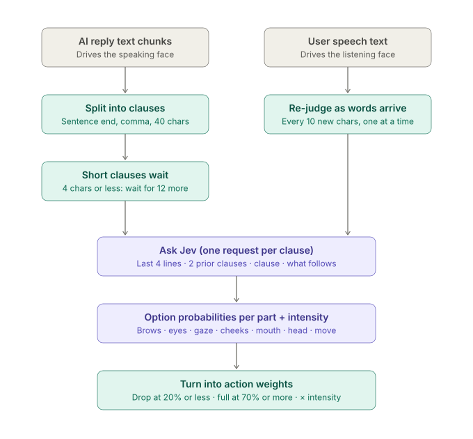
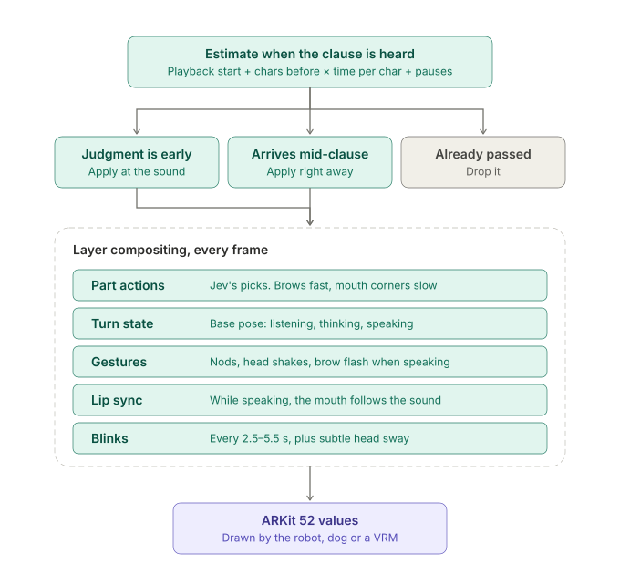

# Faceling

**English** · [한국어](README.ko.md)

**A face for your AI.** Give your voice AI a face and watch its expressions change as it talks.

> Expressions drawn from what is said, not how it sounds.

Faceling is an expression engine for voice AI. It reads the **text** of the conversation — what the AI says and what the user says — decides what each part of the face should do, and outputs ARKit 52 blendshape values in real time. Your renderer takes those values and moves whatever face you like: a robot, a dog, a VRM avatar.

## What it does

- **Speaking face.** As the AI's reply streams in, it is split into clauses and judged one by one, and each expression is timed to the moment that clause is heard.
- **Listening face.** It reacts while the user is still talking. It does not mirror the user; it reacts the way a caring listener would.
- **Context aware.** The same "I see." becomes a smile after good news and a concerned look after sad news. A short "Really?" takes its feeling from what comes right after it.
- **Per-part judgment.** For six parts of the face — brows, eyes, gaze, cheeks and nose, mouth, head — the judgment model picks an action directly. Plain, factual lines leave the face at rest.
- **Any face.** The output is ARKit 52 values, so it fits any renderer. A code-drawn robot and dog are included, and VRM models work too.
- **Lightweight.** No server-side video. Each clause costs one API call of about 0.2–0.3 s.

## Try it

Requires Node.js 22 or later.

```bash
npm install
```

Copy `.env.example` in the repository root to `.env` and fill in the keys.

| Key | Used for |
|---|---|
| `TYPESAFE_API_KEY` | Expression judgment ([Jev](https://docs.typesafe.ai/introduction)). Required |
| `OPENAI_API_KEY` | Voice conversation (OpenAI Realtime API). Without it, only the silent demo works |

```bash
npm run rt:dev
```

Open http://localhost:5174. A three-step intro asks you to pick a face and a voice, then press "마이크 허용하고 대화 시작" (allow microphone and start) or "텍스트로만 대화할게요" (text only). Without an OpenAI key you get "예시 대화 보기" (watch a sample conversation) instead, which drives the face without sound. Press `` ` `` or add `?dev` to the URL to open the developer panel. The demo UI is in Korean for now.

Pick a face in the intro or later with "캐릭터 변경" (change character): 로봇 (robot), 강아지 (dog) and 3D 모델 (3D model). The 3D option loads pixiv's sample model [VRM1_Constraint_Twist_Sample](https://github.com/pixiv/three-vrm/tree/dev/packages/three-vrm/examples/models) (© 2022 pixiv Inc., [VRM Public License 1.0](https://vrm.dev/licenses/1.0/)) from the web at runtime; it is not included in this repository. That model only has the standard VRM expressions (happy, sad, surprised and so on), so its face looks simpler than the robot and dog. Load your own VRM with ARKit blendshapes from the developer panel → "내 VRM 불러오기" (load my VRM) to see every expression.

## Project layout

| Folder | Contents |
|---|---|
| [`packages/core`](packages/core) | The engine: face parts and actions, questions sent to the judgment model, action → ARKit 52 mapping, layer compositing, real-time scheduling, the robot and dog faces |
| [`apps/realtime`](apps/realtime) | Real-time demo on the OpenAI Realtime API, with a small server that keeps the keys off the browser |
| [`apps/offline-lab`](apps/offline-lab) | Offline lab that pre-computes expressions for a recorded conversation, for tuning the mappings |

The READMEs inside each folder, the code comments and the demo UI are currently in Korean.

## How it works

### Architecture


The browser connects to OpenAI **directly**. The local server only hands out short-lived ephemeral keys while keeping the real keys to itself, and relays calls to Jev. Audio never goes through the server. The microphone feeds two connections: the conversation partner (OpenAI Realtime) and a transcription connection that delivers the user's words while they are still speaking.

### Judging an expression



**The judgment model picks the actions; the code does not.** For each face part the model is asked something like "while saying (or hearing) this line, what should the eyebrows do?" along with a list of options, and the probability of each option is used as-is.

- Speaking and listening use different question wording and option descriptions. That is why, when the user shares something hard, the face does not copy their sadness but looks concerned and sympathetic.
- A clause is never sent alone. The preceding conversation and the words that follow are sent with it. The same "Really?" becomes a pained surprise when followed by "your dog is sick…", and a delighted one when followed by "Congratulations!".
- Clauses of four characters or fewer need what follows to make sense, so their judgment waits until about twelve more characters arrive.

### Timing and compositing



The reply text arrives one to two seconds ahead of the audio, so most clauses are judged before they are heard and their expression lands right on time. The first clause of a reply, which is the most likely to be late, is pre-judged from its first few characters, and if the user has just spoken, their listening reaction bridges the gap. When the user interrupts, every scheduled expression is withdrawn.

Face parts move at different speeds: brows and eyes react quickly, while mouth corners and cheeks build up slowly and linger. Audio is used only for lip sync; emotion is read from the text alone.

To connect another voice service, write an adapter that passes its events to the engine. The events the engine accepts are listed in the [real-time demo docs](apps/realtime/README.md#구조) (Korean).

The diagrams are generated by `docs/diagrams/build.mjs`. After editing it, run `node docs/diagrams/build.mjs` to rebuild both the English and Korean versions.

## Good to know

- **Jev is the judgment model.** It is a paid API and needs a key. The analyzer is pluggable, and an LLM-based analyzer for comparison lives in `apps/offline-lab` (not yet run against a real key).
- **Tone of voice is not read.** Information that exists only in the sound, such as sarcasm in a voice whose words are polite, is not reflected. Irony that shows in the surrounding text is caught.
- **Conversation text is sent to the judgment model,** including transcripts of what the user says. Tell your users if you ship this.
- **Experimental.** Tested with Korean conversations only, and the mapping coefficients are first drafts. What has not been verified is noted in each folder's README.
- **The demo server is for your own machine.** It has no authentication, so do not expose it to a network as is.

## License

- Code: [MIT](LICENSE)
- Designs of the two built-in faces (robot and dog): [CC BY-NC 4.0](packages/core/src/rigs/LICENSE.md). Free for non-commercial use; using them as the face of a commercial product requires permission. Faces you design yourself are not affected.

© 2026 RED BRIDGE DEV
